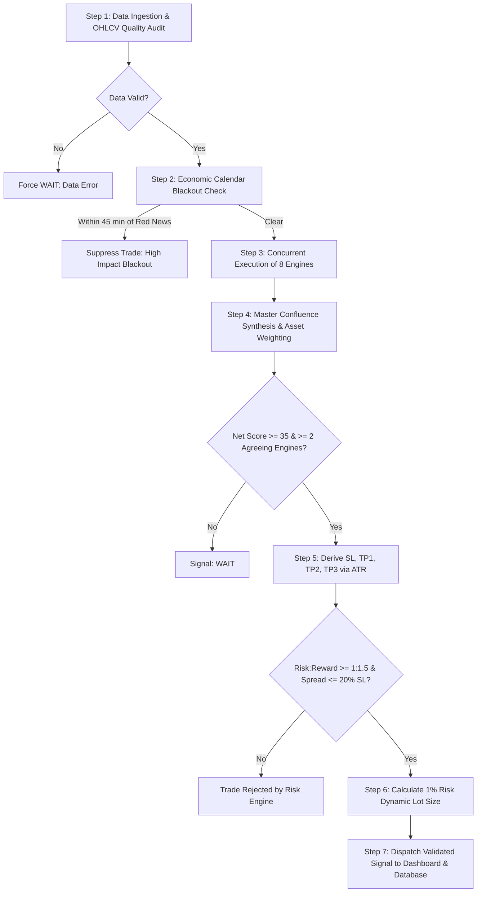

# TradeSense Pro — Algorithmic Trading Strategies Manual

This document provides a comprehensive, in-depth explanation of every trading strategy used by **TradeSense Pro** to identify, evaluate, and execute trades.

---

## 1. Master Trading Architecture & Philosophy

TradeSense Pro does not rely on a single indicator or a simplistic retail trading pattern. Retail traders frequently suffer losses because single indicators (such as basic RSI oversold levels or moving average crossovers) fail during volatile regime shifts, economic news releases, and institutional stop hunts.

To achieve institutional-grade performance, TradeSense Pro operates a **Multi-Engine Confluence Architecture**. Every trade decision is the result of **10 specialized engines** analyzing market data simultaneously, weighted by asset class, gated by strict mathematical risk rules, and protected by macroeconomic blackout circuit breakers.

---

## 2. Strategy Engine 1: Advanced SMC / ICT (Smart Money Concepts)
**Engine Weight:** 20% (Forex) | 25% (Crypto) | 20% (Metals)

Smart Money Concepts (SMC) and Inner Circle Trader (ICT) principles model how institutional liquidity providers (central banks, sovereign wealth funds, Tier-1 investment banks) manipulate and accumulate positions.

### Key Components:
1. **Market Structure Shift (MSS) & Break of Structure (BOS):**
   - The engine monitors rolling 4-candle swing highs and swing lows.
   - **Break of Structure (BOS):** When price breaks the most recent swing high in an uptrend (or swing low in a downtrend) with a candle close, confirming trend continuation.
   - **Market Structure Shift (MSS) / Change of Character (CHoCH):** When price aggressively breaks the opposite swing point with strong displacement, signaling an institutional trend reversal.

2. **Institutional Order Blocks (OB):**
   - An Order Block is the final opposing candle before a powerful, multi-candle displacement move.
   - A **Bullish Order Block** is the last down candle before a violent upward rally that creates a new swing high.
   - The engine validates an Order Block using three strict filters:
     - *Displacement Strength:* Price must move by at least 1.5× the Average True Range (ATR).
     - *Fair Value Gap Presence:* The impulse move must create an unmitigated imbalance.
     - *Freshness:* The zone must be unmitigated (price has not tapped back into it yet).

3. **Fair Value Gaps (FVG) / Imbalances:**
   - An FVG is a 3-candle price pattern where Candle 1's wick and Candle 3's wick do not overlap, leaving open, unfilled price action in Candle 2.
   - The gap size must be at least 0.25× ATR.
   - Institutional algorithms routinely retrace to fill these inefficiencies before resuming the dominant trend.

4. **Breaker Blocks & Mitigation Retest:**
   - When an established Order Block fails to hold and is cleanly breached by price, it converts into a **Breaker Block**.
   - Demand flips into supply (or supply into demand), providing a high-probability pullback entry on the retest.

5. **Liquidity Sweeps & Turtle Soup Reversals:**
   - Detects **Equal Highs (EQH - Buy-Side Liquidity)** and **Equal Lows (EQL - Sell-Side Liquidity)** where retail stop-loss orders accumulate.
   - When price spikes slightly beyond these levels to trigger retail stops and immediately snaps back inside the range with long rejection wicks, a *Liquidity Sweep* is confirmed, triggering an instant contrarian entry.

6. **Premium vs. Discount Pricing & Optimal Trade Entry (OTE):**
   - The active swing range (High to Low) is divided at the 50% equilibrium level.
   - Long trades are strictly forbidden in the **Premium zone (>50%)**.
   - Short trades are strictly forbidden in the **Discount zone (<50%)**.
   - Optimal Trade Entry (OTE) is calibrated at the **61.8% to 78.6% Fibonacci retracement level**.

7. **Institutional Time & Price Kill Zones:**
   - Trades are filtered by high-volume institutional trading sessions:
     - *Asian Range (00:00 – 08:00 UTC):* Establishes the daily consolidation boundaries.
     - *London Kill Zone (07:00 – 10:00 UTC):* Captures the Judas swing (false breakout) and session open expansion.
     - *New York Kill Zone (12:00 – 15:00 UTC):* High-volume acceleration aligning with US economic data and equity opens.

8. **Anchor Reference Levels:**
   - Continuously monitors Previous Daily High (PDH), Previous Daily Low (PDL), Previous Weekly High (PWH), and Previous Weekly Low (PWL) as major institutional draw-on-liquidity targets.

---

## 3. Strategy Engine 2: Pure Price Action & Candlestick Anatomy
**Engine Weight:** 15% across all asset classes

This engine evaluates real-time raw price behavior without lagging indicators, focusing on buyer/seller dominance, structural support/resistance, and candlestick closing mechanics.

### Key Components:
1. **Dynamic Support & Resistance Clusters:**
   - Identifies swing pivots and groups them into dense horizontal price bands.
   - Levels with 3 or more confirmed rejections are classified as high-significance institutional zones.

2. **Breakout & Retest Confirmation:**
   - A breakout is only accepted when a candle body closes completely outside the key level.
   - The engine requires a pullback retest candle that respects the broken level with rejection shadows before confirming the trade.

3. **False Breakouts (Wyckoff Spring & Upthrust):**
   - When price breaks through a key horizontal level but fails to sustain momentum and closes back inside the range within 1 to 2 candles, the engine flags a trap (Upthrust for shorts, Spring for longs).

4. **Reversal & Momentum Candlestick Formations:**
   - *Bullish / Bearish Engulfing:* The current candle body covers >= 105% of the preceding candle range.
   - *Pin Bars & Hammers:* The rejection wick must be at least 2.0× the length of the candle body.
   - *Morning Star / Evening Star:* 3-candle sequence showing momentum exhaustion, indecision, and counter-expansion.
   - *Inside Bar Breakouts:* A consolidation candle submerged entirely inside the prior mother bar, coiling energy for high-momentum continuation.

---

## 4. Strategy Engine 3: Quantitative Technical Indicators & Market Regimes
**Engine Weight:** 15% (Forex) | 20% (Crypto) | 20% (Indices)

Technical indicators serve as quantitative regime filters and momentum confirmation matrices.

### Key Components:
1. **Triple EMA Trend Stack:**
   - Uses Exponential Moving Averages: EMA 20 (Fast), EMA 50 (Intermediate), and EMA 200 (Macro Baseline).
   - An uptrend requires `Close > EMA 20 > EMA 50 > EMA 200`.
   - Golden Crosses (50 crossing 200 up) and Death Crosses (50 crossing 200 down) establish the overarching macro bias.

2. **ADX Trend Strength Filter:**
   - 14-period Average Directional Index (ADX).
   - `ADX > 25`: Confirms a strong trending environment; breakout strategies receive full weighting.
   - `ADX < 20`: Flags a ranging/choppy market; breakout trades are suppressed and mean-reversion rules activate.

3. **Multi-Timeframe RSI & Divergence Detection:**
   - 14-period Relative Strength Index tuned per asset class (Forex: 70/30; Crypto: 75/25).
   - *Regular Divergence:* Price makes a Higher High while RSI makes a Lower High (Trend exhaustion warning).
   - *Hidden Divergence:* Price makes a Higher Low while RSI makes a Lower Low (Institutional trend continuation signal).

4. **MACD Momentum Acceleration:**
   - Standard MACD (12, 26, 9) monitoring histogram slope changes to capture shifts in momentum before price reversals occur.

5. **Supertrend Dynamic Trailing Stop:**
   - 10-period ATR with a 3.0 multiplier.
   - Serves as a dynamic trailing stop-loss boundary and verifies directional momentum alignment.

6. **Volume Profile & VWAP (Volume Weighted Average Price):**
   - Computes the Point of Control (POC), representing the price level with the highest traded volume.
   - Price trading above POC signals bullish institutional control; price below POC signals bearish distribution.

---

## 5. Strategy Engine 4: Institutional Flow, COT & Derivatives
**Engine Weight:** 10% (Forex/Metals) | 15% (Crypto/Indices/Commodities)

This engine evaluates real capital commitments by hedge funds, banks, and commercial hedgers through futures and options positioning.

### Key Components:
1. **CFTC Commitments of Traders (COT):**
   - Tracks weekly net positioning of Non-Commercial Speculators (hedge funds) versus Commercial Hedgers (producers/banks).
   - Calculates a rolling 52-week percentile:
     - *> 85th Percentile:* Overcrowded long positioning. High risk of long liquidation cascades (contrarian bearish warning).
     - *< 15th Percentile:* Overcrowded short positioning. Prime candidate for a violent short squeeze (contrarian bullish alert).
     - *60% – 85% Percentile:* Healthy institutional trend accumulation.

2. **Futures Open Interest (OI) 4-Quadrant Dynamics:**
   - Correlates 24-hour price changes with Open Interest changes:
     - `Price UP + OI UP`: **Long Accumulation** — Genuine new institutional capital entering (Strong Bullish).
     - `Price UP + OI DOWN`: **Short Covering** — Rally driven solely by shorts closing; vulnerable to reversal.
     - `Price DOWN + OI UP`: **Short Addition** — Aggressive institutional short sellers entering (Strong Bearish).
     - `Price DOWN + OI DOWN`: **Long Liquidation** — Longs capitulating; market seeking an absorption floor.

3. **Options Put/Call Ratio & Implied Volatility (IV):**
   - `P/C Ratio > 1.2`: Excessive market fear (contrarian buy opportunity).
   - `P/C Ratio < 0.7`: Extreme retail complacency (contrarian top warning).

4. **Crypto Perpetual Funding Rates:**
   - Highly positive funding rates signal overleveraged long positioning prone to cascade liquidations.

---

## 6. Strategy Engine 5: Macroeconomic Regimes & Central Bank Divergence
**Engine Weight:** 15% (Forex) | 25% (Metals/Commodities) | 20% (Indices)

Currencies and commodities move primarily based on capital flows driven by interest rate differentials and economic growth.

### Key Components:
1. **Central Bank Monetary Policy Divergence:**
   - Evaluates interest rate differentials and policy biases across major central banks (Federal Reserve, ECB, BOE, BOJ, RBA, SNB).
   - Tracks Hawkish versus Dovish divergence, quantitative tightening (QT), and balance sheet changes.

2. **Economic Surprise Index:**
   - Measures the deviation between market consensus forecasts and actual data releases:
     `Surprise Score = (Actual - Forecast) / Historical Standard Deviation`
   - Covers Core CPI, PPI, Non-Farm Payrolls (NFP), Unemployment Rate, GDP, and Manufacturing PMI.

3. **US Dollar Index (DXY) & Treasury Yield Spreads:**
   - Tracks the 10-Year Treasury Yield (^TNX) and 2-Year Yield (^IRX).
   - Rising real yields strengthen the USD while applying downward pressure on Gold (XAUUSD) and equities.
   - Yield curve inversion (2Y vs 10Y spread) serves as an early recession and risk-off indicator.

4. **High-Impact News Blackout Circuit Breaker:**
   - TradeSense Pro strictly enforces an automated **45-minute blackout window** before and after red-folder economic releases (FOMC, CPI, NFP).
   - All new trade generation is paused during blackouts to eliminate catastrophic slippage and spread blowout.

---

## 7. Strategy Engine 6: Cross-Asset Intermarket Correlations & Volatility
**Engine Weight:** 5% (Forex/Crypto) | 10% (Metals/Indices/Commodities)

### Key Components:
1. **Cross-Asset Benchmark Correlations:**
   - Continuously measures correlation against benchmark assets:
     - `EURUSD vs DXY`: -0.96 benchmark inverse correlation.
     - `Gold (XAUUSD) vs DXY`: -0.82 inverse correlation; Gold vs Real Yields: -0.75.
     - `Crude Oil vs USDCAD`: -0.72 petrocurrency inverse correlation.

2. **Intermarket Divergence (Flight-to-Safety Anomalies):**
   - When historically inverse assets move together (e.g., Gold rising while DXY is also rising), the engine detects extreme geopolitical risk flight.

3. **TTM Squeeze Volatility Compression:**
   - Flags when Bollinger Bands (20, 2.0 std dev) compress entirely inside Keltner Channels (20, 1.5 ATR).
   - Represents extreme low-volatility coiling. When bands expand back outside, the engine triggers an explosive breakout alert in the direction of the momentum histogram.

---

## 8. Strategy Engine 7: Real-Time NLP News Sentiment & Geopolitics
**Engine Weight:** 15% (Forex/Crypto) | 5% (Metals/Indices)

### Key Components:
1. **Financial NLP Lexicon Scoring:**
   - Evaluates breaking news feeds using domain-specific sentiment polarity scoring.
   - Terms like *surge*, *record high*, *rate cut*, and *boom* generate positive scores; terms like *plunge*, *crisis*, *recession*, and *default* generate negative scores.

2. **Source Reliability Tiers:**
   - *Tier 1 (1.5× Multiplier):* Reuters, Bloomberg, Financial Times, Wall Street Journal.
   - *Tier 2 (1.0× Multiplier):* CNBC, MarketWatch, Yahoo Finance.
   - *Tier 3 (0.5× Multiplier):* General aggregators and social feeds.

3. **Categorical Event Filtering:**
   - Classifies headlines into Geopolitics (war, sanctions, tariffs), Central Bank statements, Financial Stress (bank runs, credit shocks), and Energy Shocks.

---

## 9. Strategy Engine 8: AI / Machine Learning Ensemble Model
**Engine Weight:** 5% (Forex) | 0% – 10% (Tuned per asset)

### Key Components:
1. **Multi-Engine Feature Store:**
   - Extracts a feature vector containing price momentum, normalized returns, moving average spreads, rolling volatility, RSI, ATR, and volume differentials over a 60-candle lookback.

2. **Supervised Ensemble Classification:**
   - Utilizes Random Forest and Gradient Boosting algorithms trained with walk-forward, out-of-sample validation to prevent look-ahead bias.

3. **Probabilistic Output:**
   - Produces class probabilities: `P(BUY)`, `P(SELL)`, and `P(WAIT)`.

4. **Deterministic Safety Constraint:**
   - The AI/ML engine operates strictly in an advisory capacity. It is mathematically forbidden from overriding deterministic risk rules or forcing trades during news blackouts.

---

## 10. Master Synthesis: Unified Confluence & Asset Weighting

The **Unified Signal Engine** serves as the central brain. It dynamically weights each engine depending on the asset class being traded:

| Engine Name | Forex | Crypto | Metals (Gold) | Indices (SPX) | Commodities |
| :--- | :---: | :---: | :---: | :---: | :---: |
| **SMC / ICT** | **20%** | **25%** | **20%** | 15% | 15% |
| **Price Action** | 15% | 15% | 15% | 15% | 15% |
| **Technical Indicators** | 15% | **20%** | 15% | **20%** | 15% |
| **Macro & Central Bank** | 15% | 5% | **25%** | **20%** | **25%** |
| **News Sentiment (NLP)** | 15% | 15% | 5% | 5% | 5% |
| **Institutional Flow / COT** | 10% | 15% | 10% | 15% | 15% |
| **Intermarket Correlation** | 5% | 5% | 10% | 10% | 10% |
| **AI / ML Ensemble** | 5% | 0% | 0% | 0% | 0% |
| **Total** | **100%** | **100%** | **100%** | **100%** | **100%** |

### Execution Thresholds:
- **Minimum 2-Engine Confluence Rule:** At least 2 independent engines must agree on the direction (BUY or SELL).
- **Net Confluence Score:** Must be `>= 35.0` on a 0–100 scale. Any score below 35 results in a mandatory **WAIT**.
- **Confidence Rating:** `Confidence = (Normalized Net Score × 0.60) + (Engine Confluence % × 0.40)`.
- **Classification:**
  - **STRONG:** Confidence `>= 70%`
  - **MODERATE:** Confidence `50% – 69.9%`
  - **WEAK / WAIT:** Confidence `< 50%`
  - *Confidence is capped at 98.0% to reflect inherent market risk.*

---

## 11. Deterministic Risk Management & Execution Rules

Capital protection is mandatory. Even if a signal achieves a 95% confidence score, it will be discarded if it violates any risk parameter:

1. **Strict Risk:Reward Ratio (Minimum 1:1.5 Mandatory):**
   - Every trade must offer a minimum projected reward-to-risk ratio of **1:1.5**.
   - Any trade with an R:R below 1.5 is rejected automatically.

2. **Multi-Tier Targets (ATR Multipliers):**
   - **Stop Loss (SL):** `Entry ± (1.5 × ATR)` (placed beyond key structural invalidation).
   - **Take Profit 1 (TP1):** `Entry ± (2.0 × ATR)` (Secures partial profit; moves SL to Breakeven).
   - **Take Profit 2 (TP2):** `Entry ± (3.5 × ATR)` (Extended structural swing target).
   - **Take Profit 3 (TP3):** `Entry ± (5.0 × ATR)` (Runner target for strong trend expansions).

3. **Mathematical Position Sizing (1% Account Risk):**
   - Lot sizes are computed dynamically per trade:
     `Lots = (Account Balance × 0.01) / (Stop Loss Distance in Points × Point Value per Lot)`
   - Keeps total portfolio risk capped at exactly 1% per trade.

4. **Spread Cost Protection:**
   - The live broker spread must not exceed **20% of the Stop Loss distance**.
   - If spreads widen excessively (e.g., during roll-over or illiquid hours), the trade is rejected.

5. **Data Quality Circuit Breakers:**
   - Audits OHLCV candle streams for zero-volume bars, missing bars, and timestamp staleness (> 2 bars old). Any data defect forces the system into **WAIT**.

---

## 12. Complete Lifecycle of a Trade

